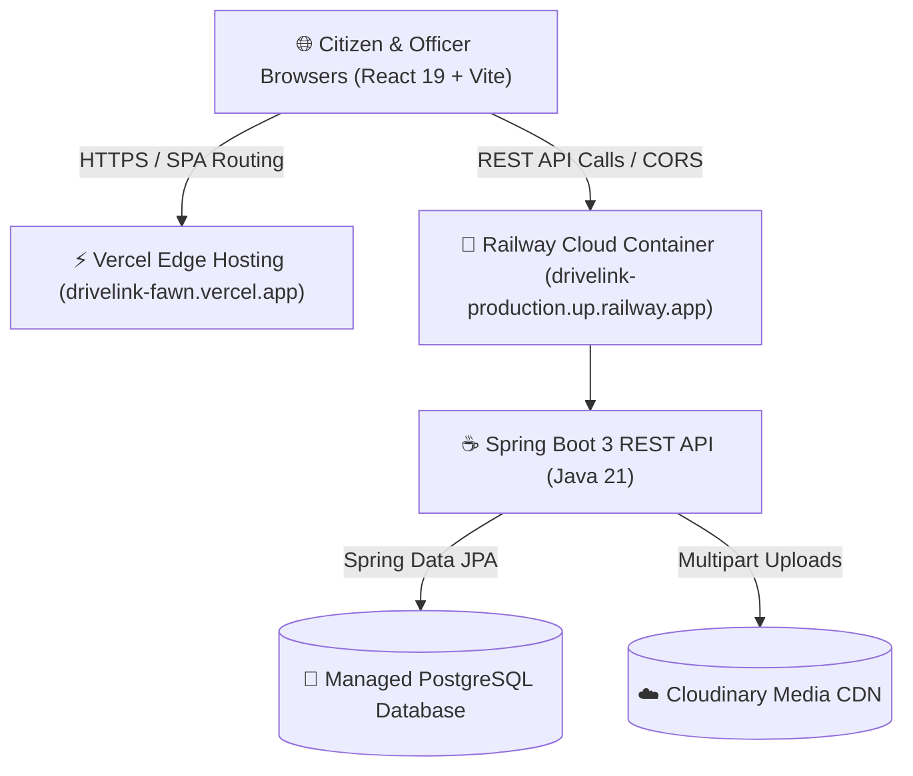

<div align="center">

  # 🚗 DriveLink
  ### National Motor Traffic Authority — Web-Based Driving License Issuing Service

  <p align="center">
    A unified, cloud-native digital government platform modernizing the driving license lifecycle in Sri Lanka.
  </p>

  <p align="center">
    <a href="https://drivelink-fawn.vercel.app" target="_blank">
      
    </a>
  </p>

  <p align="center">
    
    
    
    
    
    
    
    
    
    
    
  </p>

</div>

---

## 🔗 Live Application

The complete system is deployed and accessible in the cloud:

* **Web App :** [https://drivelink-fawn.vercel.app](https://drivelink-fawn.vercel.app)
* **Cloud Document Storage:** Cloudinary CDN

---

## 🔑 Demo Accounts (Try It Live)

The platform comes pre-seeded with realistic demonstration accounts across all 7 operational roles.

> **Default Password for all accounts:** `Password123!`

| Role | Email | Workspace Capabilities |
| :--- | :--- | :--- |
| 🧑‍💼 **Citizen / Applicant** | `citizen@demo.gov` | Submit applications, book medicals, schedule theory & practical exams, track status, view 3D digital license card, request renewal, submit support tickets |
| 📋 **Registration Officer** | `officer@demo.gov` | Review applicant dossiers, verify uploaded NIC / medical reports, approve or reject applications |
| 🗓️ **Test Coordinator** | `coordinator@demo.gov` | Manage theory exam and practical trial sessions, allocate test centers, monitor slot capacities |
| ✍️ **Driving Examiner** | `examiner@demo.gov` | Conduct practical driving trials, assess road maneuvers, submit pass/fail evaluation scores |
| 🚗 **Driving Trainer** | `trainer@demo.gov` | Review learner training schedules, conduct pre-trial training sessions, log training completions |
| 🩺 **Medical Officer** | `medical@demo.gov` | Inspect citizen medical appointments, record vision and fitness checks, issue digital clearance certificates |
| 🛡️ **System Administrator**| `admin@demo.gov` | System-wide audit logs, user account management (activate/deactivate roles), operational health monitoring |

---

## 🌟 Project Overview

The **Web-Based Driving License Issuing Service (DriveLink)** is an enterprise government portal engineered to replace paper-based driving license workflows in Sri Lanka. It resolves congestion at Department of Motor Traffic (DMT) regional offices by migrating the entire citizen journey to a responsive, transparent, and cloud-hosted system.

From initial digital medical scheduling and identity verification to automated exam slotting, driving trial scoring, digital card issuance with 3D visualization, and license renewals — every step is securely tracked in real time.

---

## ✨ Core Functional Modules

### 🩺 1. Medical Examination Management
* Citizens select accredited regional medical centers and reserve specific date/time slots.
* Authorized medical officers view booked citizens, conduct fitness/vision examinations, and submit verified digital clearance reports directly into the database.

### 📄 2. Digital Application & Cloud Document Verification
* Citizens enter personal information, license classes (A, B, C, etc.), and upload supporting documents (NIC, medical report, passport photos).
* Uploads are securely stored on **Cloudinary CDN** with optimized delivery and signed URLs.
* Registration officers review submitted attachments through a digital verification queue and approve/reject with feedback notes.

### 💻 3. Computerized Theory Examination Scheduling
* Once registration is verified, applicants schedule their computer-based theory examination at available DMT centers.
* Automated capacity throttling prevents slot overbooking.
* Test scores are recorded and instantaneously update the applicant's clearance status.

### 🚗 4. Practical Driving Trial & Trainer Coordination
* Candidates passing the theory examination can book a practical driving trial slot.
* Applicants can request DMT-certified driving trainers for preparatory sessions.
* Driving Examiners record standardized scores for vehicle maneuvering, road signs, and parking directly from a mobile or desktop interface.

### 🪪 5. License Approval & Interactive 3D Digital Card
* Following successful medical, theory, and practical clearance, officers grant final issuance approval.
* Citizens receive their active license number alongside an interactive **3D Digital Driving License Card** featuring dynamic lighting, class endorsements, and security holograms.

### 🔄 6. License Renewal & Citizen Services
* Existing drivers submit renewal requests with updated medical documents without repeating beginner trials.
* Includes a built-in Citizen Helpdesk & Support Ticket module for inquiries, duplicate issuance requests, and issue resolution.

---

## 🛠️ Technology Stack

| Layer | Technology | Purpose |
| :--- | :--- | :--- |
| **Frontend Framework** | **React 19** + **TypeScript** | Type-safe single-page application with modern hooks and state management |
| **Build & Tooling** | **Vite** | Fast Hot Module Replacement (HMR) and optimized production bundles |
| **Styling & UI** | **Tailwind CSS v4** + **Lucide Icons** | Utility-first, responsive interface with custom design tokens and dark accents |
| **Visual Effects** | **HTML5 Canvas / CSS 3D** | Interactive 3D digital driving license card |
| **Backend Framework** | **Spring Boot 3** (Java 21) | Production-ready RESTful microservice architecture |
| **Security & Auth** | **Spring Security Crypto (BCrypt)** | Secure password hashing, credential verification, and RBAC endpoint routing |
| **Persistence** | **Spring Data JPA** + **Hibernate** | Object-Relational Mapping with automatic schema updates |
| **Primary Database** | **PostgreSQL** | Relational cloud database hosted on Railway |
| **In-Memory Fallback** | **H2 Database** | Zero-configuration fallback engine ensuring continuous availability |
| **Media & File Storage**| **Cloudinary SDK** | Cloud-based document and photo uploads (NICs, medical certificates) |
| **Containerization** | **Docker** (Multi-stage build) | Reproducible builder image with lightweight Temurin JRE runtime |
| **Cloud Hosting** | **Vercel** + **Railway** | Global edge frontend deployment connected to autoscaling backend service |

---

## 🏗️ System Architecture



---

## 💻 Local Development Setup

### Prerequisites
* **Node.js** (v18 or higher) & **npm**
* **Java Development Kit (JDK 21)**
* **Git**

### 1. Clone the Repository
```bash
git clone https://github.com/Kithdhara/Drivelink.git
cd Drivelink
```

### 2. Frontend Setup
```bash
cd frontend
npm install
npm run dev
```
The frontend will start at **http://localhost:5173** and automatically proxy API calls to the local backend at `http://localhost:8080`.

### 3. Backend Setup
Open a separate terminal:
```bash
cd backend
# Windows
.\mvnw.cmd spring-boot:run

# macOS / Linux
./mvnw spring-boot:run
```
The backend starts at **http://localhost:8080** and will auto-seed demo accounts into the database on first launch.

---

## 🎓 Academic Information

* **Institution:** Sri Lanka Institute of Information Technology (SLIIT)
* **Module:** SE2030 - Software Engineering (Year 2, Semester 1 - 2026)
* **Group:** `026-Y2-S1-MLB-WEB1G2-03`
